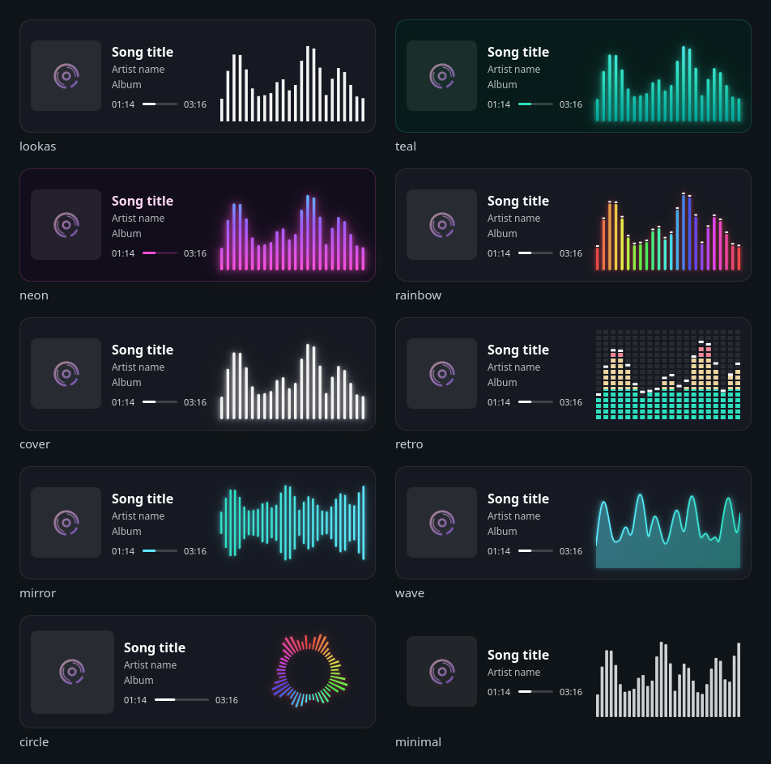

# Now Playing Visualizer

Un widget de escritorio para KDE Plasma 6 (y una tarjeta para Hyprland, con quickshell) que muestra la canción que estás escuchando —portada, título, artista y progreso— junto a un visualizador de audio en tiempo real hecho con [CAVA](https://github.com/karlstav/cava). Puede escuchar **solo las aplicaciones que elijas** (tu reproductor, no el juego ni Discord), y todo su aspecto se cambia desde una página de ajustes visual.

[Read in English](README.md)



> **Estado: versión temprana (0.4.0).** Se usa a diario en un escritorio con CachyOS y Plasma 6.8. La tarjeta de Hyprland y los paquetes de AUR son nuevos y todavía no están publicados: la tarjeta se ha visto en KDE Wayland, no en un Hyprland real. Todavía no se ha probado en otras distribuciones; mira [Limitaciones](#limitaciones).

## Funciones

- **Tarjeta de la canción** — portada, título, artista, álbum u origen y barra de progreso, leídos de cualquier reproductor compatible con MPRIS (el estándar de Linux para reproductores).
- **Controles del reproductor** — anterior, pausa y siguiente al pasar el ratón; clic o arrastre en la barra de progreso para avanzar; clic en la portada para traer el reproductor al frente; rueda del ratón para el volumen; aleatorio y repetición en los reproductores que los tienen. Cada control depende de lo que el reproductor diga que admite.
- **Elegir el reproductor** — clic derecho en el widget para mostrar uno concreto en vez del que esté sonando; cada widget recuerda el suyo.
- **Audio por aplicación** — eliges a qué aplicaciones reaccionan las barras, como en OBS. Se conectan directamente a CAVA a través de PipeWire, sin que aparezca ningún dispositivo nuevo en tu menú de sonido.
- **Colores de la canción** — la tarjeta puede tomar sus colores de la portada (siempre legibles) y mostrarla difuminada de fondo.
- **Tres estilos** — barras, bloques y onda, cada uno también en modo circular, con cinco modos de color: degradado, un color por barra, arcoíris (animado si quieres), colores sacados de la portada o el color de acento de Plasma. Picos que caen y brillo opcionales, y un ecualizador para dar forma a las barras.
- **Se adapta a su forma** — horizontal, vertical (barras debajo) o compacta, según el tamaño del widget o fijada a mano.
- **Compartir presets** — exporta tu diseño a un archivo `.json` e importa los de otras personas; de un archivo importado solo se guardan los ajustes válidos.
- **Ajustes visuales** — vista previa en vivo, presets en tarjetas, pestañas, Deshacer, y Cancelar que de verdad revierte. Por debajo, todas las opciones viven en un archivo JSON que también puedes editar a mano.
- **Estado de reposo** — cuando no suena nada puede mostrar la última canción atenuada, una tarjeta «Nada sonando», u ocultarse.
- **Pensado para sobrevivir a las actualizaciones** — las partes que dependen del interior de Plasma están aisladas y tienen alternativa, el helper solo usa la biblioteca estándar de Python, y una comprobación opcional se ejecuta tras cada actualización de `pacman` y te avisa si algo se rompió.
- **Idiomas** — inglés y español.

## Requisitos

| Qué | Para qué |
|---|---|
| KDE Plasma 6 (Qt 6) | el widget |
| PipeWire (con `pw-dump`, `pw-link`) y WirePlumber (`wpctl`) | captura de audio, audio por aplicación y volumen de reproductores sin volumen MPRIS |
| `cava` | el análisis del audio |
| Python 3.10+ (probado en 3.10, 3.12, 3.13 y 3.14) | el helper (solo biblioteca estándar) |
| `busctl` (systemd) | leer el reproductor por D-Bus cuando hace falta |
| `gettext` (`msgfmt`) | compilar las traducciones al instalar |

En sistemas basados en Arch: `sudo pacman -S cava pipewire wireplumber python gettext`.

## Instalación

```bash
git clone https://github.com/MobaiLC/now-playing-visualizer.git
cd now-playing-visualizer
tools/install.sh            # el widget
tools/install.sh --systemd  # opcional: servicio del helper + comprobación tras actualizar
```

Después reinicia Plasma (`systemctl --user restart plasma-plasmashell`, o cierra sesión y vuelve a entrar), haz clic derecho en el escritorio → **Añadir elementos gráficos…** → **Now Playing Visualizer**.

Otras formas, cuando estén publicadas (todavía no lo están):
- **AUR:** `now-playing-visualizer` (versiones) o `now-playing-visualizer-git` (último commit). Los PKGBUILD están en [`packaging/aur/`](packaging/aur/). Instalan el widget y la tarjeta de Hyprland para todos los usuarios, junto con las unidades de systemd, que no se activan hasta que tú lo hagas. Si antes lo instalaste desde git, quita primero esa instalación de usuario (mira [Desinstalar](#desinstalar)): la copia de `~/.local/share` se usa antes que la del paquete.
- **KDE Store / archivo `.plasmoid`:** créalo con `tools/make-plasmoid.sh` e instálalo con `kpackagetool6 -t Plasma/Applet -i build/now-playing-visualizer-*.plasmoid`.

`--systemd` instala dos unidades de usuario:
- `nowplaying-viz.service` mantiene el helper en marcha y lo reinicia si falla.
- `nowplaying-viz-check.path` ejecuta una comprobación tras cada actualización de paquetes.

Las dos son opcionales: sin ellas, el widget arranca el helper por su cuenta.

Para actualizar, haz `git pull` y vuelve a ejecutar `tools/install.sh`.

### Desinstalar

```bash
kpackagetool6 -t Plasma/Applet -r com.github.mobailc.nowplayingvisualizer
systemctl --user disable --now nowplaying-viz.service nowplaying-viz-check.path
rm ~/.config/systemd/user/nowplaying-viz*
rm -r ~/.config/nowplaying-viz   # tus ajustes y presets
```

### Hyprland

En Hyprland (sin Plasma) el mismo helper alimenta una tarjeta dibujada con [quickshell](https://quickshell.org), que debe estar instalado (`sudo pacman -S quickshell`). `tools/install.sh --systemd` copia todo a `~/.local/share/plasma/plasmoids/…` e imprime la línea que debes añadir a tu configuración de Hyprland:

```
exec-once = quickshell -p ~/.local/share/plasma/plasmoids/com.github.mobailc.nowplayingvisualizer/contents/quickshell
exec-once = systemctl --user start nowplaying-viz
```

La segunda línea arranca el helper: sin uwsm, Hyprland nunca llega a `graphical-session.target`, que es donde se activa el servicio. Con uwsm no molesta.

Con el paquete de AUR la ruta es `/usr/share/now-playing-visualizer/quickshell`. El tamaño, la esquina, los márgenes y el monitor son las opciones `desktop.*` de `config.json` (mira [docs/CONFIG.md](docs/CONFIG.md)); `hyprctl monitors` lista los nombres de los monitores. Después:

```bash
nowplaying-viz check    # valida config.json (salida 0 = bien)
nowplaying-viz doctor   # revisa programas, servicio, helper, reproductores y configuración
```

Para quitarlo: borra las dos líneas `exec-once`, luego `systemctl --user disable --now nowplaying-viz.service nowplaying-viz-check.path` y `rm -r ~/.local/share/plasma/plasmoids/com.github.mobailc.nowplayingvisualizer ~/.local/bin/nowplaying-viz ~/.config/systemd/user/nowplaying-viz*`.

### Usarlo con un agente de IA

[`AGENTS.md`](AGENTS.md) es una guía para asistentes de IA: instalar, cambiar el aspecto y arreglar problemas. Para dárselo a Claude Code como skill (el paquete de AUR la incluye; no se enlaza nada por ti):

```bash
ln -s /usr/share/now-playing-visualizer/skill ~/.claude/skills/now-playing-visualizer
```

## Configuración

Clic derecho en el widget → **Configurar…**

- **Diseño** — vista previa en vivo arriba y, debajo, pestañas: *Presets* (clic en una tarjeta para aplicarla, o guarda los tuyos), *Estilo*, *Colores*, *Movimiento*, *Panel* y *Avanzado*. Los cambios se ven al momento; **Aplicar/Aceptar** los guarda y **Cancelar** lo deja todo como estaba.
- **Audio** — marca las aplicaciones que debe escuchar el visualizador. Si no marcas ninguna, escucha todo el sistema. O activa **Seguir al reproductor que muestra el widget** para escuchar solo el reproductor que esté sonando, sin mantener una lista.

### Ventana de ajustes (Hyprland y otros escritorios)

Sin Plasma no hay **Configurar…**: ejecuta `nowplaying-viz settings`, elige *Ajustes de Now Playing Visualizer* en tu lanzador o haz clic derecho en la tarjeta del escritorio. Abre las mismas páginas de Diseño y Audio en su propia ventana.

Todo se guarda en `~/.config/nowplaying-viz/config.json`, que también puedes editar a mano; el widget se actualiza al guardar el archivo:

```json
{
  "version": 2,
  "preset": "lookas",
  "audio": { "apps": ["liner"] },
  "overrides": { "bars": { "side": "left", "glow": { "enabled": true } } },
  "presets": {}
}
```

Los colores van en formato web, `#RRGGBB` o `#RRGGBBAA`. La lista completa de opciones, con tipos, rangos y valores por defecto, está en [`schema.json`](package/contents/code/schema.json). Si un valor no es válido se corrige y el widget lo indica con un icono de aviso, en vez de romperse.

## Reproductores compatibles

Los controles solo aparecen si el reproductor dice que los admite. El volumen (rueda del ratón) funciona con cualquier reproductor: por MPRIS si lo tiene (Zen/Firefox) y, si no, cambiando el volumen del audio de la propia aplicación (Liner).

| Reproductor | Pausa | Siguiente/anterior | Avanzar | Cómo se ha probado |
|---|---|---|---|---|
| Liner | ✅ | ✅ | ✅ | en directo |
| Zen / Firefox (YouTube, etc.) | ✅ | ✅ | ✅ | en directo |
| Riff | ✅ | ✅ (si hay canción siguiente o anterior en la cola) | ✅ | en directo: datos de la canción y barras; controles solo leyendo su código |
| Spotify (cliente oficial) | ✅ | ✅ | ⚠️ | en directo: datos de la canción, barras, y aleatorio/repetición; los demás controles sin probar a mano. Según informes, su MPRIS está incompleto (la posición puede quedarse en 0) |
| Haruna | ? | ? | ? | en directo: datos de la canción y barras; controles sin probar |
| mpv | – | – | – | necesita el plugin `mpv-mpris` para que el widget lo vea; sin él solo funcionan las barras, con la lista de apps |

Los botones de aleatorio y repetición solo aparecen en los reproductores que los ofrecen (Spotify, mpv con `mpv-mpris`…; Firefox, Zen y Chromium no). Se agradecen informes de otros reproductores.

## Cómo funciona

```
 Widget de Plasma (QML)  ──WebSocket, 127.0.0.1:47811──  helper.py  ──  CAVA ── PipeWire
   Card · Bars · página Diseño                                │
   MprisSource ── módulo MPRIS de Plasma                      └── MPRIS por D-Bus (alternativa)
```

- **El widget** dibuja la tarjeta y las barras, y lee la canción con el módulo MPRIS de Plasma.
- **El helper** es un pequeño programa en Python que comparten todos los widgets. Se encarga de:
  - juntar los presets con tus ajustes y validarlos con `schema.json`;
  - ejecutar CAVA solo mientras algún widget necesita barras;
  - conectar a CAVA las aplicaciones elegidas;
  - leer la canción por D-Bus si alguna vez cambia el módulo de Plasma.
- **Su conexión** solo escucha en `127.0.0.1`, rechaza conexiones que vengan de páginas web y no se conecta a internet.

## Solución de problemas

- **Comprobarlo todo** — dice qué falta o está roto, a qué afecta y qué hacer (`--json` para herramientas, `--notify` para una notificación):
  ```bash
  nowplaying-viz doctor
  ```
  `nowplaying-viz check` solo valida `config.json`.
- **Registros del helper:** `journalctl --user -u nowplaying-viz` (servicio) o `~/.cache/nowplaying-viz.log` (arrancado por el widget).
- **Errores del widget:** `journalctl --user -u plasma-plasmashell | grep nowplayingvisualizer`.
- **¿No hay barras?** Comprueba que la aplicación está marcada en **Audio** (o que no hay ninguna, para todo el sistema, o que **Seguir al reproductor** está activado) y que `cava` está instalado.

## Limitaciones

- La información de la canción viene de un **módulo privado de Plasma** (el que usa su controlador multimedia). Si una actualización lo cambia, el widget pasa solo a usar D-Bus, pero puede hacer falta algún arreglo.
- **Hace falta PipeWire**; PulseAudio sin PipeWire no está soportado.
- Los controles del reproductor (botones, avanzar en la canción, volumen con la rueda) solo se han probado a mano en Liner y en YouTube con Zen. En Riff, Spotify y Haruna solo se han comprobado los datos de la canción y las barras.
- Solo se ha probado en CachyOS con Plasma 6.8.

## Desarrollo

Empieza por [CONTRIBUTING.md](CONTRIBUTING.md), en inglés: cómo preparar el entorno, qué comprobaciones ejecutar y recetas paso a paso (añadir una opción, un estilo de barras, un modo de color, un preset o una traducción). Después, según lo que necesites:

- [docs/ARCHITECTURE.md](docs/ARCHITECTURE.md) — las piezas y cómo circulan los datos entre ellas.
- [docs/CONFIG.md](docs/CONFIG.md) — todas las opciones, generado desde `schema.json`.
- [docs/PROTOCOL.md](docs/PROTOCOL.md) — los mensajes entre el widget y el helper.
- [docs/adr/](docs/adr/README.md) — por qué cada cosa está hecha así.
- [CHANGELOG.md](CHANGELOG.md).

```
package/            el plasmoide (se instala tal cual)
  contents/ui/        QML: main, NowPlaying, Card, Bars, páginas Diseño y Audio, MprisSource
  contents/ui/renderers/  un archivo JS por estilo de barras, colores, geometría común
  contents/code/      helper.py, cli.py, schema.json, presets/*.json
packaging/          unidades de systemd, PKGBUILD de AUR, install.sh
tests/              tests del helper (python3 -m unittest discover -s tests)
tools/              instalar, crear el .plasmoid, traducciones, documentación de opciones
translate/          plantilla de gettext y traducciones
```

## Transparencia

Este proyecto se escribe con ayuda de **Claude** (la IA de Anthropic) mediante Claude Code, bajo la dirección del autor, que decide qué se construye y revisa el resultado. Los commits hechos así llevan una línea `Co-Authored-By: Claude`. Sus mensajes explican cómo se probó cada cambio y, con la misma claridad, qué *no* se probó.

## Créditos

- [CAVA](https://github.com/karlstav/cava) hace el análisis del audio.
- Inspirado en [lookas](https://github.com/rccyx/lookas) y en [Plasma Audio Visualizer](https://github.com/luisbocanegra/plasma-audio-visualizer) / Kurve. No se ha copiado código de ninguno de los dos.

## Licencia

[GPL-3.0-or-later](LICENSE)
