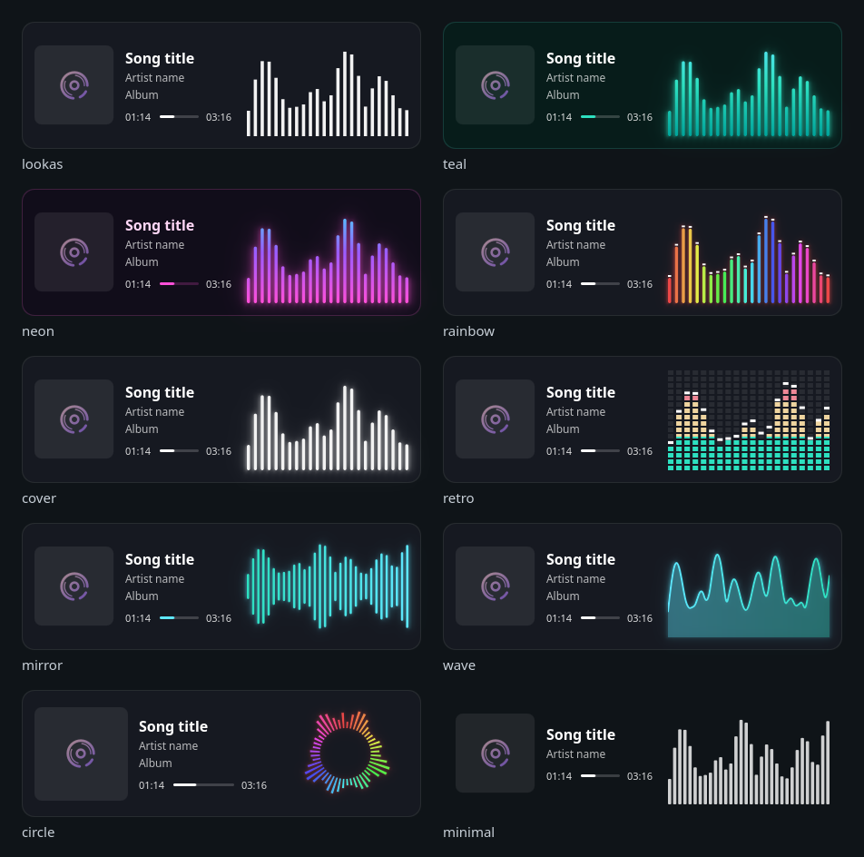

# Now Playing Visualizer

A KDE Plasma 6 desktop widget that shows the song you're listening to — cover art, title, artist and progress — next to a real-time audio visualizer powered by [CAVA](https://github.com/karlstav/cava). It can listen to **only the apps you choose** (your music player, not your game or Discord), and everything about its look can be changed from a visual settings page.

[Leer en español](README.es.md)



> **Status: early (0.1.0).** It works daily on one CachyOS + Plasma 6.8 desktop. It has not been tested on other distributions yet; see [Limitations](#limitations).

## Features

- **Now playing card** — cover art, title, artist, album/source and a progress bar, read from any player that supports MPRIS (the Linux standard for media players).
- **Player controls** — previous, play/pause and next on hover; click or drag the progress bar to seek; click the cover to bring the player forward; mouse wheel for volume. Each control follows what the player says it supports.
- **Per-app audio** — pick which apps the bars react to, OBS-style. The apps are linked straight into CAVA through PipeWire; no extra audio device appears in your sound menu.
- **Three styles** — bars, blocks and wave, each also available in a circular mode, with five colour modes: gradient, one colour per bar, rainbow (optionally animated), colours taken from the cover art, or your Plasma accent colour. Falling peaks and glow are optional.
- **Adapts to its shape** — horizontal, vertical (bars below) or compact, chosen automatically from the widget's size or fixed by hand.
- **Visual settings** — a live preview, presets shown as cards, tabs, Undo, and Cancel that really reverts. Under the hood, every option lives in a JSON file you can also edit by hand.
- **Idle state** — when nothing plays it can show the last song dimmed, a "Nothing playing" card, or hide.
- **Built to survive updates** — the parts that depend on Plasma internals are isolated with fallbacks, the helper uses only Python's standard library, and an optional check runs after every `pacman` upgrade and notifies you if something broke.
- **Languages** — English and Spanish.

## Requirements

| What | Why |
|---|---|
| KDE Plasma 6 (Qt 6) | the widget itself |
| PipeWire (with `pw-dump`, `pw-link`) and WirePlumber (`wpctl`) | audio capture, per-app routing, volume for players without MPRIS volume |
| `cava` | the audio analysis |
| Python 3.10+ (tested on 3.10, 3.12, 3.13 and 3.14) | the helper (standard library only) |
| `busctl` (systemd) | reading the player over D-Bus when needed |
| `gettext` (`msgfmt`) | building the translations at install time |

On Arch-based systems: `sudo pacman -S cava pipewire wireplumber python gettext`.

## Install

```bash
git clone https://github.com/MobaiLC/now-playing-visualizer.git
cd now-playing-visualizer
tools/install.sh            # the widget
tools/install.sh --systemd  # optional: helper service + post-update check
```

Then restart Plasma (`systemctl --user restart plasma-plasmashell`, or log out and in), right-click the desktop → **Add Widgets…** → **Now Playing Visualizer**.

Other ways, once they are published (not yet):
- **AUR:** `plasma6-applets-now-playing-visualizer-git`. The PKGBUILD is in [`packaging/aur/`](packaging/aur/PKGBUILD). It installs the widget for every user, plus the systemd units, which stay disabled until you enable them.
- **KDE Store / a `.plasmoid` file:** build one with `tools/make-plasmoid.sh` and install it with `kpackagetool6 -t Plasma/Applet -i build/now-playing-visualizer-*.plasmoid`.

The `--systemd` option installs two user units:
- `nowplaying-viz.service` keeps the helper running and restarts it if it crashes.
- `nowplaying-viz-check.path` runs a self-check after each package upgrade.

Both are optional: without them, the widget starts the helper by itself.

To update, run `git pull` and then `tools/install.sh` again.

### Uninstall

```bash
kpackagetool6 -t Plasma/Applet -r com.github.mobailc.nowplayingvisualizer
systemctl --user disable --now nowplaying-viz.service nowplaying-viz-check.path
rm ~/.config/systemd/user/nowplaying-viz*
rm -r ~/.config/nowplaying-viz   # your settings and presets
```

## Configuration

Right-click the widget → **Configure…**

- **Design** — live preview at the top, then tabs: *Presets* (click a card to apply it, or save your own), *Style*, *Colors*, *Motion*, *Panel* and *Advanced*. Changes show immediately; **Apply/OK** keeps them and **Cancel** puts everything back.
- **Audio** — tick the apps the visualizer should listen to. With none ticked it listens to the whole system. Or tick **Follow the player shown in the widget** to listen only to whichever player is playing, without keeping a list.

Everything is stored in `~/.config/nowplaying-viz/config.json`, which you can also edit by hand; the widget reloads when the file is saved:

```json
{
  "version": 2,
  "preset": "lookas",
  "audio": { "apps": ["liner"] },
  "overrides": { "bars": { "side": "left", "glow": { "enabled": true } } },
  "presets": {}
}
```

Colours use web notation, `#RRGGBB` or `#RRGGBBAA`. The full list of options, with types, ranges and defaults, is in [`schema.json`](package/contents/code/schema.json). Invalid values are corrected and flagged with a warning icon on the widget instead of breaking it.

## Player compatibility

Controls are offered only when the player reports it supports them. Volume (mouse wheel) works with every player: through MPRIS when the player has it (Zen/Firefox), otherwise by changing the app's own audio stream (Liner).

| Player | Play/pause | Next/previous | Seek | Tested how |
|---|---|---|---|---|
| Liner | ✅ | ✅ | ✅ | live |
| Zen / Firefox (YouTube, etc.) | ✅ | ✅ | ✅ | live |
| Riff | ✅ | ✅ (when the queue has a next/previous track) | ✅ | live: song info and bars; controls only from its source code |
| Spotify (official client) | ✅ | ✅ | ⚠️ | live: song info and bars; controls not tested by hand. Its MPRIS support is reported to be incomplete (position may stay at 0) |
| Haruna | ? | ? | ? | live: song info and bars; controls not tested |
| mpv | – | – | – | needs the `mpv-mpris` plugin to show up at all; without it only the bars work, through the app list |

Reports for other players are very welcome.

## How it works

```
 Plasma widget (QML)  ──WebSocket, 127.0.0.1:47811──  helper.py  ──  CAVA ── PipeWire
   Card · Bars · Design page                               │
   MprisSource ── Plasma's MPRIS module                    └── MPRIS over D-Bus (fallback)
```

- **The widget** draws the card and the bars, and reads the song through Plasma's MPRIS module.
- **The helper** is a small Python program shared by all widgets. It:
  - merges presets with your settings and validates them against `schema.json`;
  - runs CAVA only while a widget needs bars;
  - links the selected apps into CAVA;
  - serves as the fallback song reader if Plasma's module ever changes.
- **Its connection** only listens on `127.0.0.1`, refuses connections from web pages, and makes no network requests.

## Troubleshooting

- **Check everything** — prints what is missing or broken and what it affects (from the AUR package, use `/usr/share/…` instead of `~/.local/share/…`):
  ```bash
  python3 ~/.local/share/plasma/plasmoids/com.github.mobailc.nowplayingvisualizer/contents/code/check.py
  ```
- **Helper logs:** `journalctl --user -u nowplaying-viz` (service) or `~/.cache/nowplaying-viz.log` (started by the widget).
- **Widget errors:** `journalctl --user -u plasma-plasmashell | grep nowplayingvisualizer`.
- **No bars?** Make sure the app is ticked under **Audio** (or none is, for the whole system, or **Follow the player** is on) and that `cava` is installed.

## Limitations

- Song info comes from a **private Plasma module** (the one the media controller uses). If an update changes it, the widget falls back to D-Bus automatically, but fixes may be needed.
- **PipeWire is required**; plain PulseAudio is not supported.
- Player controls (buttons, seeking, mouse-wheel volume) have been tested by hand on Liner and on YouTube in Zen only. On Riff, Spotify and Haruna only the song info and the bars have been checked.
- Only tested on CachyOS with Plasma 6.8.

## Development

Start with [CONTRIBUTING.md](CONTRIBUTING.md): set-up, checks to run, and step-by-step recipes (add an option, a bar style, a colour mode, a preset, a translation). Then, as needed:

- [docs/ARCHITECTURE.md](docs/ARCHITECTURE.md) — the pieces and how data flows between them.
- [docs/CONFIG.md](docs/CONFIG.md) — every option, generated from `schema.json`.
- [docs/PROTOCOL.md](docs/PROTOCOL.md) — the messages between the widget and the helper.
- [docs/adr/](docs/adr/README.md) — why things are built the way they are.
- [CHANGELOG.md](CHANGELOG.md).

```
package/            the plasmoid (installed as-is)
  contents/ui/        QML: main, Card, Bars, Design and Audio pages, MprisSource
  contents/ui/renderers/  one JS file per bar style, colours, shared geometry
  contents/code/      helper.py, schema.json, presets/*.json, check.py
packaging/          systemd user units, AUR PKGBUILD
tests/              helper unit tests (python3 -m unittest discover -s tests)
tools/              install, make-plasmoid, translations, config docs
translate/          gettext template and translations
```

## Transparency

This project is written with the help of **Claude** (Anthropic's AI) through Claude Code, under the direction of the author, who decides what gets built and reviews the result. Commits made this way carry a `Co-Authored-By: Claude` line. Their messages say how each change was tested and, just as clearly, what was *not* tested.

## Credits

- [CAVA](https://github.com/karlstav/cava) does the audio analysis.
- Inspired by [lookas](https://github.com/rccyx/lookas) and [Plasma Audio Visualizer](https://github.com/luisbocanegra/plasma-audio-visualizer) / Kurve. No code was copied from either.

## License

[GPL-3.0-or-later](LICENSE)
